## 기말과제
- 성명 : 김수연

- 게임 이름 : Shooting Apple

- 장르 : 1인칭 슈팅(FPS) + 퍼즐 + 스코어 어택

---

## 게임 레퍼런스

- 사과게임 フルーツボックス (후르츠 박스 / Fruit Box)

### 레퍼런스 게임의 주요 규칙

- 사과에 랜덤한 숫자가 적혀 있음

- 두 개 이상의 사과를 드래그해 박스에 담고, 숫자 합이 10이 되면 점수를 획득

- 매 판마다 사과에 랜덤한 숫자가 배정됨

- 사과를 한 번에 많이 제거할수록 높은 점수를 얻을 수 있음

- 제거된 사과의 자리는 자동으로 채워지지 않고 빈 공간으로 남음

### 추가 설정

- 기존 숫자 퍼즐 요소에 1인칭 FPS 요소를 추가하여 Shooting Apple로 구성

---

## 게임 개요

- 플레이어는 제한시간 90초 동안 사과나무에 달린 사과를 원거리 수확 장비로 떨어뜨림

- 떨어지는 사과는 플레이어와 함께 좌우로 이동하는 바구니로 받아야 함

- 바구니에 담긴 사과의 숫자 합이 정확히 10이 되면 수확 성공으로 판정되어 점수를 획득함

- 상태가 좋은 사과는 추가 점수를 주고, 상태가 좋지 않은 사과는 감점 요소가 됨

- 제한시간 종료 후 획득한 최종 Score로 결과를 확인하는 1인용 스코어 어택 게임

---

## 게임 목적

- 제한시간 90초 안에 가능한 많은 사과를 수확

- 바구니에 담긴 사과 숫자의 합을 정확히 10으로 만들어 점수를 획득

- 황금 사과 등 특수 사과를 활용하여 높은 점수를 노림

- 합계가 10을 초과하여 바구니가 파손되는 상황을 피함

- 최종적으로 가장 높은 Score를 기록하는 것이 목표

---

## 게임 스토리

- 매년 한 번, 사과 농장 마을에서는 특이한 방식의 사과 수확 대회가 열린다

- 이 대회에서는 손으로 사과를 따는 것이 금지되어 있으며,
	참가자는 원거리 수확 장비로 사과를 떨어뜨린 뒤 바구니에 받아야 한다
	
- 주인공은 농장 수리비와 생활비를 마련하기 위해 대회의 상금을 노리고 참가한다

---

## 조작 방법

- 사격 : 마우스 좌클릭
- 조준 : 마우스 이동
- 이동 : A, D
- 재시작 : R
- 종료 : ESC

> 플레이어는 1인칭 시점에서 좌우로만 이동

---

## 게임 규칙

### 기본 규칙

- 일반 사과와 여러 종류의 특수 사과가 등장

- 사과를 정확히 사격하면 해당 사과가 나무에서 떨어짐

- 플레이어는 A, D로 좌우 이동하며 떨어지는 사과를 바구니로 받아야 함

- 바구니에 담긴 2개 이상의 사과 숫자 합이 10이 되면 점수를 획득하고 바구니가 초기화됨

- 숫자 합이 10을 초과하면 바구니가 파손되며 해당 조합에는 점수를 부여하지 않고 바구니가 초기화됨

- 숫자 합이 10 미만이면 계속해서 사과를 수확할 수 있음

### 특수 사과

- 일반 사과 : 기본 점수 계산에 사용

- 황금 사과 : 성공 조합에 포함되면 사과 1개당 +20 Score

- 멍든 사과 : 성공 조합에 포함되면 사과 1개당 -5 Score

- 벌레먹은 사과 : 성공 조합에 포함되면 사과 1개당 -10 Score

- 바구니가 파손된 경우 특수 사과의 추가점수 및 감점은 적용되지 않음

### Score 계산

- 기본 Score = 바구니에 담긴 사과 개수 × 10

- 추가 Score = (사과 개수 - 2) × 10

- 추가 Score는 3개 이상의 사과로 합계 10을 만들었을 때부터 적용

예시:

- 2개 = 20 Score

- 3개 = 30 Score + 추가 Score 10 = 40 Score

- 4개 = 40 Score + 추가 Score 20 = 60 Score

### 승부 방식

- 1인용 스코어 어택 방식

- 제한시간 종료 시 획득한 최종 Score가 플레이 결과가 됨

- 높은 Score를 기록할수록 대회에서 더 좋은 성적을 거둔 것으로 표현

### 게임 시작 / 종료 조건

- Game Start 버튼을 클릭하면 게임 시작

- 게임 시작과 동시에 제한시간 90초 카운트 시작

- 시작 시 Score는 0, 바구니는 빈 상태로 초기화

- 제한시간이 모두 지나면 게임 종료

- 결과 화면에서 최종 Score 표시

- R 키로 재시작, ESC 키로 종료

---

## 플레이 시스템

### 플레이어 행동

- 마우스로 조준점을 움직여 사과를 조준

- 마우스 좌클릭으로 원거리 수확 장비 발사

- 명중한 사과는 나무에서 떨어짐

- A, D 키를 이용해 바구니와 함께 좌우로 이동

- 떨어지는 사과를 바구니로 받아 숫자 합계를 관리

- 현재 바구니 합계를 고려하여 다음에 떨어뜨릴 사과를 선택

### 이동 연출

- 화면의 좌우 경계 없이 이동할 수 있도록 월드가 반복되어 표시됨

- 실제 플레이어 위치는 화면에 고정하고, 배경과 나무가 반대 방향으로 움직여 이동을 표현

- 이동 중 `IdleWalk_Gun1 ~ IdleWalk_Gun5`를 순서대로 재생하여 걷기 애니메이션 표현

- 이동 중 바닥, 울타리, 나무가 위아래로 미세하게 움직여 걷는 느낌을 표현

- 이동 중 `WalkSound.wav`가 반복 재생되며 이동을 멈추면 사운드도 정지

### 사과 생성

- 사과는 앞쪽 나무와 뒤쪽 나무에 각각 생성

- 나무 전체가 아닌 나뭇잎 영역 안에서만 랜덤하게 생성

- 하나의 나무에는 여러 개의 사과가 생성될 수 있음

- 생성된 사과끼리 일정 거리 이상 떨어지도록 하여 서로 겹치지 않게 배치

- 각 사과에는 1~9 사이의 랜덤한 숫자가 부여됨

- 일반 사과, 황금 사과, 멍든 사과, 벌레먹은 사과 중 하나가 랜덤하게 생성됨

- A, D 이동으로 새로운 나무 구간이 나타날 때 해당 나무의 사과가 생성되도록 구성

---

## 장애 요소

- 사과 숫자 합계가 10을 초과하면 바구니가 파손되고 해당 조합의 점수를 얻지 못함

- 제한시간이 계속 감소하므로 빠른 조준과 판단이 필요

- 멍든 사과와 벌레먹은 사과는 성공 조합에 포함될 경우 감점 요소가 됨

- 별도의 적 캐릭터는 등장하지 않음

---

## 게임 화면 구성

- 기준 화면 크기 : 360 x 540

- 화면 상단 좌측 : 남은 제한시간

- 화면 상단 우측 : 현재 Score

- 화면 중앙 : 사과나무와 수확 가능한 사과

- 마우스 위치 : 조준점

- 화면 하단 : 원거리 수확 장비(1인칭 스프라이트)

- 화면 우측 하단 : 간단한 조작법

- 화면 하단 또는 플레이어 위치 : 수확용 바구니

- 결과 화면 : 최종 Score + 사과가 담긴 바구니 이미지 + 재시작/종료 안내

### 화면 레이어 순서

1. 하늘 배경

2. 바닥 배경

3. 울타리

4. 뒤쪽 사과나무

5. 뒤쪽 나무에 달린 사과

6. 앞쪽 사과나무

7. 앞쪽 나무에 달린 사과

8. 바구니 뒷면

9. 떨어지는 사과

10. 바구니 앞면

11. 원거리 수확 장비

12. Score / Time / 조작 UI

13. 조준점

---

## 게임 진행 흐름

Game Start 버튼 클릭

→ 사과 생성

→ 마우스로 조준

→ 사과 사격

→ 사과 낙하

→ A, D로 바구니와 함께 이동

→ 바구니로 사과 획득

→ 담긴 사과 숫자 합산

→ 합계 확인

- 10 미만 : 계속 수확

- 10 도달 : 점수 계산 후 바구니 초기화

- 10 초과 : 바구니 파손 후 초기화, 점수 없음

> 특수 사과가 포함된 경우에도 합계가 10을 초과해 바구니가 파손되면 추가점수 및 감점은 적용되지 않음.

---

## 주요 게임 객체 목록

- Player : 1인칭 시점의 플레이어, A/D 이동

- HarvestTool : 원거리 수확 장비, 대기/이동/사격 애니메이션

- Crosshair : 마우스 위치를 따라 이동하는 조준점

- Apple : 1~9의 숫자를 가지는 일반/특수 사과 객체

- Basket : 떨어지는 사과를 받으며 현재 숫자 합계를 보관

- AppleTree : 앞/뒤 레이어로 배치되며 나뭇잎 영역에 사과가 생성되는 오브젝트

- GameTimer : 제한시간 90초 관리

- ScoreSystem : 기본 점수, 다중 수확 보너스, 특수 사과 점수 관리

- ResultScreen : 최종 Score와 결과 이미지 표시

---

## 씬별 화면 예시

### Scene 1 - 게임 시작 화면

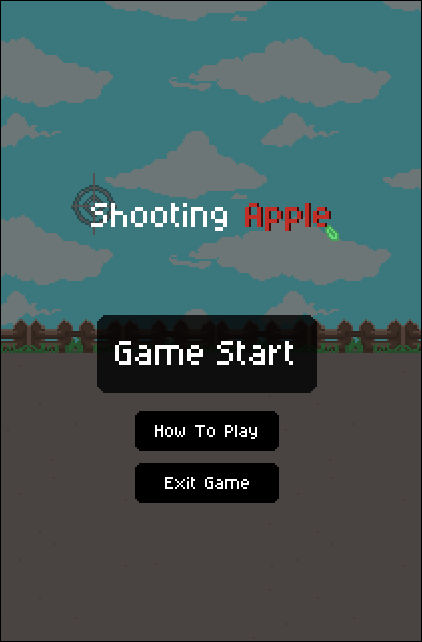

- 중앙 : 게임 제목, Game Start 버튼

- 중앙 아래 : 게임 설명 버튼, 게임 종료 버튼

### Scene 2 - 게임 플레이 화면

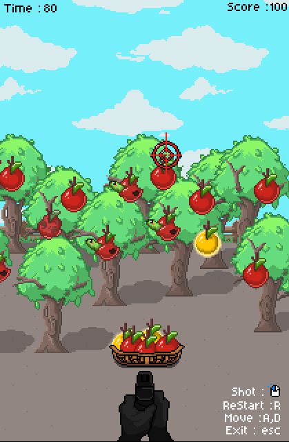

- 좌측 상단 : 제한시간

- 우측 상단 : Score

- 중앙 : 배경, 나무, 사과

- 마우스 위치 : 조준점

- 중앙 아래 : 원거리 수확 장비

- 우측 아래 : 간단한 조작법

### Scene 3 - 게임 종료 화면

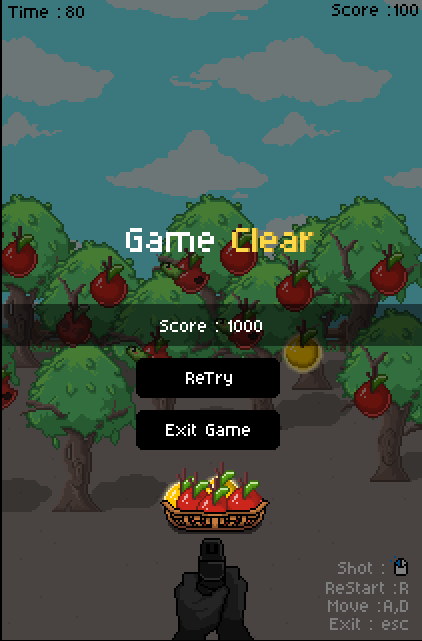

- 중앙 : 게임 클리어, 최종 Score

- 중앙 아래 : 결과용 바구니 이미지

- 하단 : 재시작 버튼, 게임 종료 버튼

---

## 제작 리소스

### 사과

> 숫자는 별도의 숫자 이미지가 아닌 텍스트로 사과 위에 표시하며, 모든 사과에 1~9의 값이 부여됨.

### 농장 배경

### 바구니

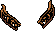

### 원거리 수확 장비

기본 이미지:

걷기 애니메이션:

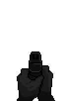

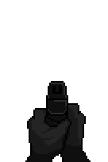

사격 애니메이션:

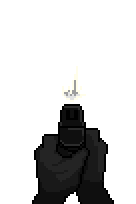

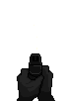

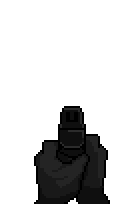

### UI


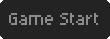

---

## 사용 사운드

> 사용 효과음 출처 : Soundly

- 버튼 클릭 : [ButtonClick.wav](./resource/Sound/ButtonClick.wav)

- 걷기 : [WalkSound.wav](./resource/Sound/WalkSound.wav)

- 원거리 수확 장비 발사 : [AirGunShot.wav](./resource/Sound/AirGunShot.wav)

- 사과 명중 : [Hit_Target.wav](./resource/Sound/Hit_Target.wav)

- 사과 낙하 : [FallApple.wav](./resource/Sound/FallApple.wav)

- 사과 바구니 획득 : [Apple_Basket_In.wav](./resource/Sound/Apple_Basket_In.wav)

- 바구니 파손 : [Broken_Basket.wav](./resource/Sound/Broken_Basket.wav)

- 합계 10 성공 : [Total10_Basket.wav](./resource/Sound/Total10_Basket.wav)

- 게임 종료 : [Clear_Sound.wav](./resource/Sound/Clear_Sound.wav)

- 배경음악: [BGM.wav](./resource/Sound/BGM.wav)
